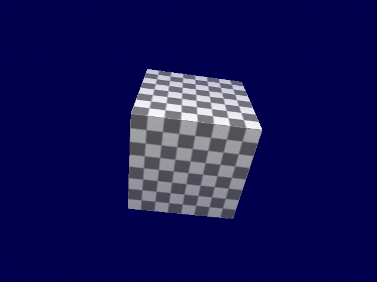
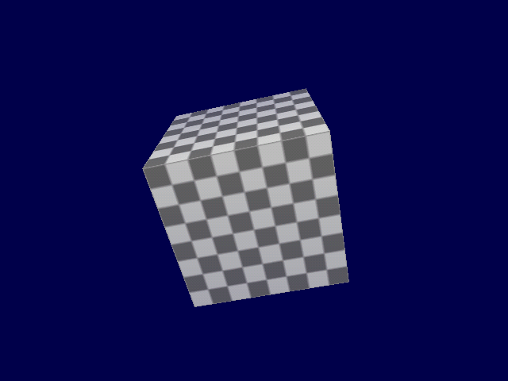
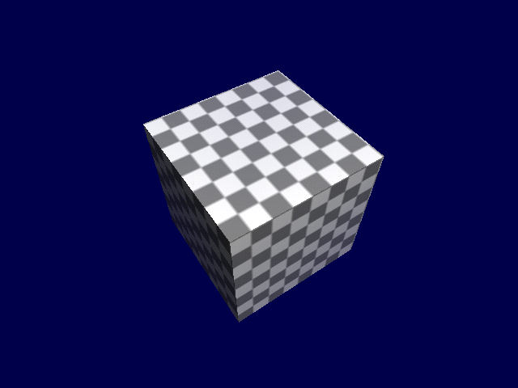
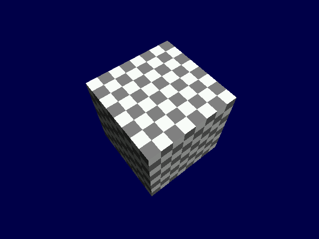
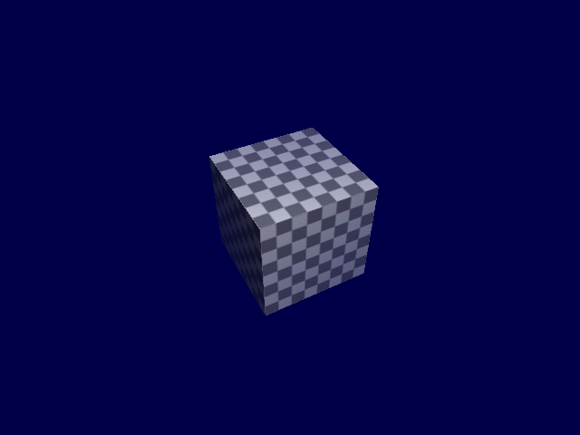
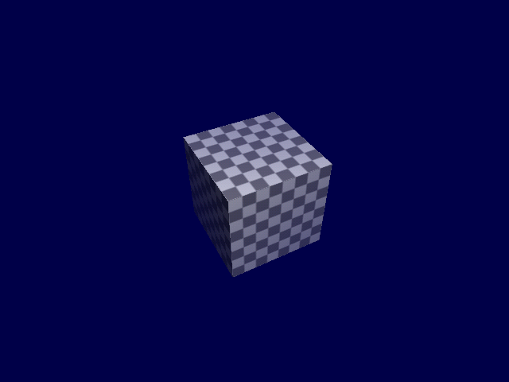
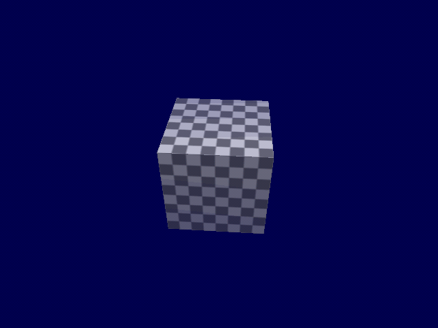
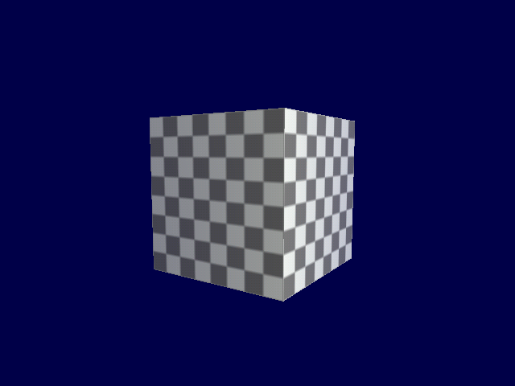
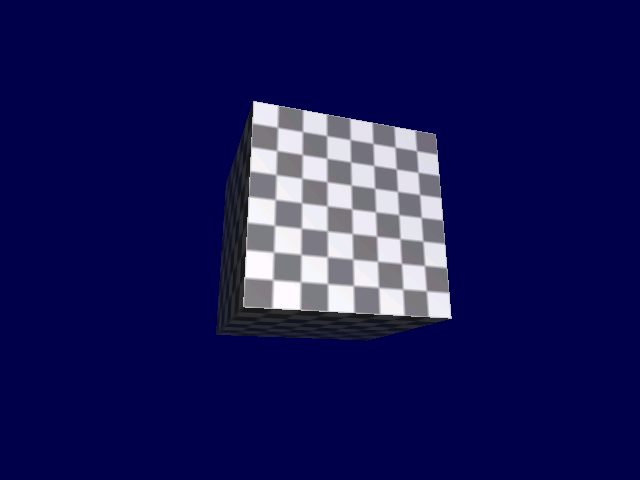

# The Glide back end

The Glide back end gives the triangles, lines and points of a softgl
context to a 3dfx Voodoo card through Glide 2. The cards are the
Voodoo Graphics, the Voodoo Rush, the Voodoo2, the Banshee and the
Voodoo3. On 32-bit DOS, a built-in driver gives the Glide functions on
the Voodoo Graphics, the Voodoo2, the Banshee and the Voodoo3, and
other built-in drivers give them on a PowerVR PCX2 card,
on an S3 ViRGE card, on a Matrox card, on an ATI Rage card, on an ATI
Rage 128 card, on the graphics of a SiS 530 or SiS 620 chipset and on
a 3Dlabs Permedia 2 card (not tested). The
code is in
`backends/glide/`.

softgl still does the GL state, the transform, lighting, clipping and
culling. The card does the rasterization: Gouraud shading, the
textures of units 0 and 1, mipmaps, the Z buffer, the alpha test,
blending, fog, the color mask and the scissor box.

## How to get the Glide functions

The back end calls Glide through a table of functions,
`sgl_glide_api` in `include/softgl_glide.h`. Fill the table in one of
these three ways:

- **Windows 95 and 98.** `sgl_glide_load(&api)` loads `glide2x.dll`
  and gets each function. It gives 0 when the DLL is not there or when
  a function is missing. `sgl_glide_unload(&api)` frees the DLL. Link
  `libsoftgl-glide.a` (from `make glide`).
- **32-bit DOS, with the driver of softgl.** `sgl_glide_sst1(&api)`
  fills the table with a driver that writes the registers of a Voodoo
  Graphics card directly. A Glide library is not necessary. Use the
  clang-retro `i386-pc-msdos` target (`--config=dos32.cfg`) and link
  `libsoftgl-glide-dos.a` (from `make glide-dos`). Refer to
  [The Voodoo driver for DOS](#the-voodoo-driver-for-dos) and
  [How to select a driver for DOS](#how-to-select-a-driver-for-dos).
- **A 32-bit DOS extender, with the Glide library of 3dfx.** Link the
  Glide 2 library of the 3dfx SDK, include its `glide.h`, and fill the
  table with `SGL_GLIDE_FILL(&api)`. Compile `backends/glide/glide.c`
  with the program.

## How to use it

1. Make the context and give it a color buffer of the size of the
   screen (`sgl_set_buffer`). This buffer is for the primitives that
   softgl draws itself.
2. Fill an `sgl_glide`: `api`, `width`, `height`, `refresh` (0 for
   60 Hz), `hwnd` (the window on Windows, or 0) and `flags`.
3. Call `sgl_glide_attach(&g, ctx)`. It opens the screen of the card.
   When it gives 0, the context stays in software.
4. Draw, and call `sgl_present(ctx)` after each frame. It swaps the
   buffers of the card. `SGL_GLIDE_NO_VSYNC` stops the wait for the
   vertical retrace.
5. `sgl_destroy_context` (or `sgl_set_backend(ctx, NULL, NULL)`) closes
   the screen and stops Glide.

The size must be a Glide resolution, for example 640 x 480 or
800 x 600.

`examples/glide/glidecube.c` shows all the steps: a cube with a
mipmapped texture and fog. Run it as `glidecube [frames]`. It stops at
Esc, after 30 seconds, or after the given number of frames.

## When softgl draws

The card draws a primitive only when it can do the GL state. softgl
draws the primitive in software when one of these is true:

- Color index mode, the logical operation, the stencil test, or
  `glDrawBuffer(GL_NONE)`.
- A color mask that is not the same for red, green and blue.
- The polygon or line stipple, smooth points, lines or polygons, or
  point size attenuation.
- An occlusion query.
- Fog with `GL_FOG_COORDINATE`, or fog without a perspective
  projection. The fog table of Glide uses the eye depth, which only a
  perspective projection gives in w.
- A blend equation other than `GL_FUNC_ADD`, separate blend factors for
  alpha, or a blend factor that Glide does not have (for example the
  constant color).
- A texture that is not 2D, a paletted texture, a depth texture, a
  texture that is not RGB or RGBA, or a texture environment other than
  `GL_MODULATE`, `GL_REPLACE` and `GL_DECAL`.
- A texture larger than 256 texels on a side, or with a ratio of width
  to height larger than 8.
- A texture on unit 1 with a card that has one TMU. With two TMUs,
  unit 1 must use `GL_MODULATE`, and unit 0 `GL_MODULATE` or
  `GL_REPLACE`.
- The secondary color together with a texture. Glide has one iterated
  color.

Then the back end waits for the card and copies the frame and the Z
buffer to the buffers of softgl through `grLfbLock`. Before the next
primitive on the card, it copies the changed buffers back. These copies
are slow, so a program is fast only when most of its primitives stay
on the card.

`glClear` goes to the card for the color and depth buffers, also for a
scissor box.

## How the back end uses Glide

- The screen origin is the lower left. The locks of the frame use the
  upper left, because row 0 of softgl is the top row.
- The depth is in the Z buffer, as `z * 65535` in `ooz`.
- The back end snaps x and y to 1/16 pixel, as Glide requires.
- Textures go to the card as RGB 565 or ARGB 4444, with all the mipmaps
  to 1 x 1 when the filter is a mipmap filter. A texture does not cross
  a 2 MB boundary of texture memory. When the texture memory is full,
  the back end frees all the textures on the card and loads them again
  when they are necessary.
- Wide lines and large points are two triangles.
- The fog of GL (linear, exp and exp2) goes to the fog table of Glide.

## The Voodoo driver for DOS

`backends/glide/glide_sst1.c` has the Glide 2 functions that the back
end uses. These functions write the registers of the card. They do not
use a Glide library. `backends/dos/dos_hw.c` has the functions for the
hardware (`include/softgl_dos.h`):

- PCI configuration mechanism 1 (ports 0CF8h and 0CFCh), to find the
  card and to read its base address.
- DPMI functions 0800h and 0801h, to map the 16 MB of the card into the
  address space of the program.
- A clock in milliseconds.

The driver does these steps:

1. `grGlideInit` finds the first PCI function with the IDs 121Ah:0001h
   (Voodoo Graphics), 121Ah:0002h (Voodoo2), 121Ah:0003h (Banshee) or
   121Ah:0005h (Voodoo3), sets the memory space bit of its PCI command
   register, and maps BAR 0.
2. `grSstWinOpen` resets the chips, sets the frame buffer and the video
   timing, and gives the monitor to the Voodoo. The resolutions are
   512 x 384, 640 x 400, 640 x 480 and 800 x 600.
3. The draw functions calculate the start values and the gradients of
   each triangle, and write them to the floating point registers.
4. `grSstWinClose` gives the monitor back to the VGA card.

**The Banshee and the Voodoo3** have a VGA and one memory for the
screen, the 3D buffers and the textures. The 3D registers are the
registers of the Voodoo Graphics, at offset 200000h of BAR 0. For
these cards, the driver does other steps:

- `grSstWinOpen` sets a VBE mode of 16-bit color (5:6:5) with the
  linear frame buffer: 640 x 480, 800 x 600 or 1024 x 768. Video
  memory holds three color buffers (two when the memory is small),
  the depth buffer, and then the textures. The driver writes the
  addresses of the buffers to `colBufferAddr` and `auxBufferAddr`, and
  the last row of the screen to the Y origin of `miscInit0`.
- The driver writes the textures through the texture window at offset
  600000h of BAR 0. `texBaseAddr` is in bytes.
- `grBufferSwap` shows the new buffer through VBE function 4F07h, and
  sets `colBufferAddr` to the next back buffer.
- `grLfbLock` gives a copy of the buffer in system memory.

The driver has these limits:

- One board, one TMU, 16-bit color, a 16-bit Z buffer and two color
  buffers.
- The texture formats RGB 565 and ARGB 4444.
- **The video clock is not set.** A real Voodoo Graphics card needs
  the PLL of its DAC set for each resolution. The driver does not do
  this yet. DOSBox-X does not need it. Test the driver on a real card
  before you use it.
- The Voodoo2 uses the same registers for most functions, but the
  driver is not tested on a Voodoo2.
- The Banshee and the Voodoo3 are tested in 86Box only. The driver
  uses one TMU of the Voodoo3.

To build the library, the example and the test:

```sh
make OUT=build-dos32 CC="clang --config=dos32.cfg" \
  CXX="clang++ --config=dos32.cfg" AR=llvm-ar all glide-dos
```





## The ViRGE driver for DOS

`backends/glide/glide_virge.c` has the same Glide 2 functions for the
3D engine of an S3 ViRGE card. The back end uses it as it uses a
Voodoo. The cards are the ViRGE, ViRGE/VX, ViRGE/DX, ViRGE/GX,
ViRGE/GX2 and Trio3D/2X.

The driver does these steps:

1. `grGlideInit` finds the first PCI function with the vendor ID 5333h
   and the device ID of a ViRGE, and reads BAR 0.
2. `grSstWinOpen` sets a VBE mode of 15-bit color (5:5:5) at the
   resolution, and maps the linear frame buffer and the register
   window ("new MMIO", 16 MB after the frame buffer). When the VBE BIOS
   has no linear frame buffer (VBE 1.2), the driver sets the address
   of the frame buffer in the registers CR59 and CR5A of the card.
3. Video memory holds three color buffers (two when the memory is
   small), the 16-bit Z buffer, and then the textures.
4. The draw functions calculate the start values and the gradients of
   each triangle, and write them to the 3D registers. Lines and points
   are two triangles.
5. `grBufferClear` uses the rectangle fill of the 2D engine.
6. `grBufferSwap` shows the new buffer through VBE function 4F07h.
   With two buffers, the driver first waits for the vertical retrace.
7. `grSstWinClose` sets the text mode again.

The ViRGE draws less than a Voodoo. The driver sets the `limits` of
its table (the `SGL_GLIDE_LIMIT_` flags in `include/softgl_glide.h`).
When a draw needs a function that the card does not have, the back end
gives the draw to softgl, and softgl draws it in software:

- The only blend is (source alpha, 1 - source alpha).
- No alpha test and no color mask.
- The fog uses the vertex alpha. Thus, no fog with a blend.
- The alpha is the texture alpha or the vertex alpha. It is not the
  product of the two.
- Only square textures. The formats are RGB 565 (stored as ARGB 1555)
  and ARGB 4444.
- **A clamped texture wraps.** The card has no clamp mode.
- The driver is tested in 86Box only. Test it on a real card before you
  use it.



## The Matrox driver for DOS

`backends/glide/glide_mga.c` has the same Glide 2 functions for the
drawing engine of a Matrox card. The cards are the Mystique, the
Mystique 220, the Millennium II and the Productiva G100. The driver
does not support the Millennium (it has no texture engine).

The driver also accepts the G200 (device IDs 0520h and 0521h), the G400
and G450 (0525h) and the G550 (2527h). The drawing engine of these cards
has the registers of the G100, and the driver uses them as on a G100.
The driver does not use the WARP setup engine of these cards. 86Box does
not emulate these cards. **The driver is not tested on them.**

The driver does these steps:

1. `grGlideInit` finds the first PCI function with the vendor ID 102Bh
   and the device ID of a supported card. It maps the registers (the
   control aperture). On the Mystique, the registers are at BAR 0; on
   the other cards, they are at BAR 1.
2. `grSstWinOpen` sets a VBE mode of 16-bit color (5:6:5) with the
   linear frame buffer. Video memory holds three color buffers (two
   when the memory is small), the 16-bit Z buffer, and then the
   textures.
3. The engine draws trapezoids. The driver divides each triangle into
   two trapezoids (the rows above the middle vertex, and the rows from
   it). It calculates the Bresenham terms of the edges, and the start
   values and the gradients of Z, the color and the texture
   coordinates (S, T and Q). Lines and points are two triangles.
4. `grBufferClear` fills the clip window with a trapezoid of one color.
5. `grBufferSwap` shows the new buffer through VBE function 4F07h, as
   the ViRGE driver does.

The driver has these limits. The back end gives a draw that needs one
of them to softgl:

- No blend and no alpha test.
- No fog on the Mystique and the Millennium II. On the G100 and later, the fog of
  a textured triangle is calculated for each pixel. The fog of a
  triangle without a texture is calculated at the vertices.
- The alpha is the texture alpha or the vertex alpha. It is not the
  product of the two.
- **No mipmaps.** The card uses the largest level of a texture.
- The Mystique and the Millennium II use the nearest texel. The G100
  and later also have the bilinear filter (86Box shows small errors with it).
- The texture formats are RGB 565 and ARGB 4444.
- The driver is tested in 86Box only. Test it on a real card before you
  use it.

The Matrox engine of 86Box does not always continue a trapezoid from
the registers of the trapezoid before it. Thus, the driver writes all
the registers for each trapezoid.



## The ATI driver for DOS

`backends/glide/glide_ati.c` has the same Glide 2 functions for the 3D
engine of an ATI mach64 card. The cards are the 3D Rage, the 3D Rage
II, II+ and IIc, the 3D Rage Pro, the Rage LT Pro, the Rage XL and XC,
and the Rage Mobility. The Rage 128 has a different engine and its own
driver (see below).

The driver does these steps:

1. `grGlideInit` finds the first PCI function with the vendor ID 1002h
   and the device ID of a supported card. A Rage Pro is found before
   the older cards. The driver maps the register window at BAR 2:
   block 1, then block 0. When BAR 2 has no address (the 3D Rage), the
   driver uses the last 2 KB of the first 8 MB of the linear aperture
   (BAR 0), and sets bit 27 of `BUS_CNTL` to open block 1 there.
2. `grSstWinOpen` sets a VBE mode of 16-bit color (5:6:5) with the
   linear frame buffer. Video memory holds three color buffers (two
   when the memory is small), the 16-bit Z buffer, and then the
   textures with their mipmaps.
3. The driver draws the triangles. The two engines are different (see
   below). Lines and points are two triangles.
4. `grBufferClear` fills the clip window with the rectangle fill of the
   2D engine: the back buffer, then the Z buffer.
5. `grBufferSwap` shows the new buffer through VBE function 4F07h, as
   the other drivers do.

**The Rage Pro and later cards** have a setup engine. For each
triangle, the driver writes the three vertices: X and Y in quarter
pixels, Z (16.16), the color, the fog factor, and S, T and W as IEEE
floats. Then it writes one over the area of the triangle. This write
starts the triangle. The engine calculates the edges and the gradients
itself.

**The 3D Rage and the Rage II** draw trapezoids. The driver divides each
triangle into two trapezoids, as the Matrox driver does. It calculates
the Bresenham terms of the edges, and the start values and the
gradients of the color, the alpha and Z. These engines have no
perspective division: S and T are quadratics of the screen position.
The driver uses the quadratic that agrees with the perspective texture
at the three vertices and at the middles of the three edges. A large
triangle with a strong perspective (one W more than 1.5 times another)
is divided into four triangles, at most two times.

The cards do Gouraud shading, the texture (replace, modulate and decal),
mipmaps (the nearest level), the bilinear filter, the Z buffer, the
blend, fog, the color mask and the scissor box. The Rage Pro also does
the alpha test. The driver has these limits. The back end gives a draw
that needs one of them to softgl:

- The blend and the fog use the same unit of the card: no fog with a
  blend.
- One texture unit.
- The 3D Rage and the Rage II have no alpha test and no clamp of the
  texture. The alpha is the texture alpha or the vertex alpha. It is
  not the product of the two.
- The texture formats are RGB 565 and ARGB 4444.
- The driver is tested in 86Box only. Test it on a real card before you
  use it.





## The PowerVR driver for DOS

`backends/glide/glide_pvr.c` has the same Glide 2 functions for the
PowerVR PCX2 of NEC and VideoLogic (PCI ID 1033h:0046h). The card has
no frame buffer and no VGA. It is installed with a 2D card. The PCX2
keeps all the triangles of a frame, then draws the frame in tiles of 32
pixels. It writes the pixels into the linear frame buffer of the 2D
card through bus mastering.

The driver does these steps:

1. `grGlideInit` finds the card, maps its registers (BAR 0) and its 4
   MB of texture memory (BAR 1), and sets bus mastering.
2. `grSstWinOpen` sets a VBE mode of 16-bit color (5:6:5) with the
   linear frame buffer on the 2D card. Two color buffers must fit in
   video memory. The driver gets up to 384 KB of DOS memory for the
   ISP parameters (the planes and the tile list), and writes its
   physical pages into the page table of the card.
3. For each triangle, the driver writes a shading block (TSP) into the
   texture memory and four planes into the ISP memory: the depth plane
   and the three edges. The planes are IEEE floats.
4. `grBufferSwap` writes the tile list, starts the render and waits for
   its end. The card writes the frame into the back buffer. Then the
   driver waits for the vertical retrace and shows the new buffer
   through VBE function 4F07h.

The card has no Z buffer. It sorts the opaque triangles by their
depth plane in each tile. Without a depth test, the driver gives each
triangle a depth that is nearer than the triangle before it.

The card does the texture, the bilinear filter and the perspective
correction. Its textures are square, with a side of 32 to 256 texels.
The driver stretches a texture that is not square or that is smaller
to a square.
For Gouraud shading, the card has one color and one intensity for each
vertex. The driver gives:

- A flat triangle when the three colors are equal.
- A color times the intensity when the colors have one hue.
- Other colors without a texture: a flat triangle and one or two
  translucent passes with a ramp texture.

Fog is a translucent pass of the fog color with the fog of each vertex.
A blend is a translucent pass. Translucent triangles must come from
back to front.

The driver has these limits. The back end gives a draw that needs one
of them to softgl:

- No alpha test, no color mask and no clamp of the texture.
- The blend is the source alpha blend only. No fog with a blend.
- **No mipmaps.** The card uses the largest level of a texture.
- With a texture or a blend, the vertex colors must have one hue.
- The alpha is the texture alpha or the vertex alpha. It is not the
  product of the two.
- The card does not show the 2D card. Use a 2D card with a VBE BIOS
  that has a linear frame buffer (the S3 ViRGE BIOS of 86Box has no
  linear frame buffer).
- The driver is tested in 86Box only. Test it on a real card before you
  use it.



## The Rage 128 driver for DOS

`backends/glide/glide_r128.c` has the same Glide 2 functions for the 3D
engine of an ATI Rage 128 card. The cards are the Rage 128 GL and VR,
the Rage 128 Pro, the Rage 128 Pro Ultra, the Rage 128 4X, the Rage
Fury, the Xpert 128 and the Rage Mobility M3 and M4.

The Rage 128 draws only from the command packets of its command engine
(the CCE). The driver writes the packets with the processor (the PIO
mode of the CCE). Each pair of dwords goes to `PM4_FIFO_DATA_EVEN`
(1000h) and `PM4_FIFO_DATA_ODD` (1004h). Before each pair, the driver
makes sure that the FIFO has two free entries (`PM4_STAT`, bits 0 to
11).

The driver does these steps:

1. `grGlideInit` finds the first PCI function with the vendor ID 1002h
   and the device ID of a Rage 128 chip. The driver maps the registers
   (BAR 2, 16 KB).
2. `grSstWinOpen` sets a VBE mode of 16-bit color (5:6:5) with the
   linear frame buffer. Video memory holds three color buffers (two
   when the memory is small), the 16-bit Z buffer, and then the
   textures with their mipmaps. The driver loads the CCE microcode
   (see below), starts the CCE in the PIO mode with 192 FIFO entries,
   and writes the 3D state that does not change.
3. For each triangle, the driver writes the changed 3D state with
   type-0 packets. Then it writes one `3D_RNDR_GEN_PRIM` packet with
   the three vertices: X, Y, Z, 1/W, the color, the fog factor, and S
   and T. The engine calculates the edges, the gradients and the
   perspective division. Lines and points are two triangles.
4. `grBufferClear` fills the clip window with a `PAINT_MULTI` packet:
   the back buffer, then the Z buffer. After a fill, the driver writes
   the 3D state again, as the r128 DRM driver of Linux does.
5. `grBufferSwap` waits until the CCE and the engine are idle, and
   shows the new buffer through VBE function 4F07h, as the other
   drivers do.

**The microcode.** The CCE runs microcode, and the BIOS does not load
it. On a real card, put the file `R128CCE.BIN` in the current
directory, or set the environment variable `SGL_R128_CCE` to the path
of the file. The file is `r128/r128_cce.bin` of linux-firmware: 256
entries of two big-endian 32-bit words (2048 bytes). softgl does not
include the file. Without the file, the driver starts the CCE without
new microcode. 86Box does not need the microcode.

The card does Gouraud shading, the texture (replace, modulate and
decal), the alpha of the texture, of the vertex or the product of the
two, mipmaps (the nearest level), the bilinear filter, the clamp of
the texture, the Z buffer, the alpha test, the blend with fog, the
color mask and the scissor box. The driver sets no limits. These
limits stay:

- One texture unit.
- The texture formats are RGB 565 and ARGB 4444.
- The driver is tested in 86Box only (`ati_xpert128_pci`). Test it on a
  real card before you use it.



## The SiS driver for DOS

`backends/glide/glide_sis.c` has the same Glide 2 functions for the 3D
engine of the SiS 6306: the graphics in the north bridge of the SiS 530
and SiS 620 chipsets (PCI ID 1039h:6306h).

The driver does these steps:

1. `grGlideInit` finds the graphics and maps the MMIO window (BAR 1,
   64 KB).
2. `grSstWinOpen` sets a VBE mode of 16-bit color (5:6:5) with the
   linear frame buffer. Video memory (the shared memory of the
   chipset) holds three color buffers (two when the memory is small),
   the Z buffer, and then the textures with their mipmaps.
3. For each triangle, the driver writes the changed 3D state
   registers, then the three vertices: X, Y, Z, the color, the fog
   factor, and U, V and 1/W as IEEE floats. A write of `TFIRE` (89FCh)
   starts the triangle. The engine calculates the edges, the gradients
   and the perspective division. Lines and points are two triangles.
4. `grBufferClear` fills the clip window with the rectangle fill of the
   2D engine: the back buffer, then the Z buffer. The driver waits for
   the end of each fill, because the 3D engine does not wait for the 2D
   engine.
5. `grBufferSwap` shows the new buffer through VBE function 4F07h, as
   the other drivers do.

The Z buffer has 15 bits in each 16-bit word. The driver converts the
Z values of `grBufferClear` and of the locks of the Z buffer.

The engine draws a pixel whose center is on an edge for the two
triangles of the edge. Thus the driver moves all the vertices by a
small offset (1/256 pixel in x, 1/512 pixel in y): the edges of a
usual model then do not go through the centers of the pixels, and a
blend does not draw a pixel two times.

The card does Gouraud shading, the texture (replace and modulate), the
alpha of the texture, of the vertex or the product of the two, mipmaps
(the nearest level), the bilinear filter, the clamp of the texture,
the Z buffer, the alpha test, the blend with fog and the scissor box.
The driver has these limits. The back end gives a draw that needs one
of them to softgl:

- No color mask.
- No `GL_DECAL` of an RGBA texture (`SGL_GLIDE_LIMIT_DECAL`).
- One texture unit.
- The texture formats are RGB 565 and ARGB 4444.
- The driver does not dither.
- The register facts come from the SiS 6306 model of 86Box only. The
  driver is tested in 86Box only (the Gigabyte GA-5SMM board,
  `--machine 5smm --card internal`). Test it on a real computer before
  you use it.



## The Permedia 2 driver for DOS

`backends/glide/glide_pm2.c` has the same Glide 2 functions for the 3D
engine of a 3Dlabs Permedia 2 or Permedia 2v card (PCI IDs 104Ch:3D07h,
3D3Dh:0007h and 3D3Dh:0009h). The register facts come from the TVP4020
PERMEDIA 2 Programmer's Reference Manual of Texas Instruments. 86Box
does not emulate the card. **The driver is not tested.**

The driver does these steps:

1. `grGlideInit` finds the card and maps the registers (region 0,
   128 KB). It sets the PCI disconnect: a write to a full input FIFO
   then waits, and is not lost.
2. `grSstWinOpen` sets a VBE mode of 16-bit color (5:6:5) with the
   linear frame buffer. Video memory holds three color buffers (two
   when the memory is small), the 16-bit Z buffer (the "localbuffer")
   and then the textures. The card gives the address of a pixel from
   the "partial products" of the row width. Thus the width of the rows
   must be a width of Appendix C of the manual (640, 800 and 1024 are).
3. For each triangle, the driver writes the changed state registers,
   then the three vertices to the vertex store of the Delta unit (the
   set-up unit in the chip): X, Y, Z, the color, the fog factor, and
   S, T and Q as IEEE floats. The DrawTriangle command starts the
   triangle. The Delta unit calculates the edges and the gradients.
   Lines and points are two triangles.
4. `grBufferClear` fills the clip window with a rectangle of one raw
   16-bit value (the `UseConstantFBWriteData` mode): the back buffer,
   then the Z buffer. This mode does not need SGRAM.
5. `grBufferSwap` waits for the Sync tag at the output FIFO, then shows
   the new buffer through VBE function 4F07h.

S and T are in texels, times Q = 1/W. The Delta unit normalizes S, T
and Q before the set-up.

The card does Gouraud shading, the texture (`GL_MODULATE`, `GL_DECAL`
and `GL_REPLACE`), the bilinear filter, the clamp of the texture, the
Z buffer, the fog, the dither, the color mask and the scissor box. The
driver has these limits. The back end gives a draw that needs one of
them to softgl:

- No alpha test (`SGL_GLIDE_LIMIT_ALPHA_TEST`).
- The only blend is (source alpha, 1 - source alpha)
  (`SGL_GLIDE_LIMIT_BLEND`).
- **No mipmaps.** The card uses the largest level of a texture.
- One texture unit.
- The texture formats are RGB 565 and ARGB 4444.

## How to select a driver for DOS

A DOS program calls `sgl_glide_dos(&api, name)`. The name is
`"voodoo"`, `"powervr"`, `"virge"`, `"matrox"`, `"ati"`, `"rage128"`,
`"sis"`, `"permedia2"` or `NULL`. With `NULL`, the function
selects the first card that it finds. `glidecube.exe` and
`glidetest.exe` take the name as an argument:

```sh
glidecube 0 matrox
```

## Tests

- `tests/glide.c` runs in `make check`. It gives the back end a fake
  Glide table and examines the calls: the vertices, the copies of the
  buffers, the textures, the two units, the fog table and the other
  state. The output is `PASS softgl glide`.
- `tools/test-glide-wine.sh OUT` builds `glidecube.exe` and a fake
  `glide2x.dll` (`tests/wine/fake_glide2x.c`) for Windows 95, and runs
  the example in Wine for 30 frames. It examines the number of opened
  screens, the swaps and the bad vertices. CI runs it.
- `tests/dos/glidetest.c` is a test of the DOS drivers. It
  draws a clear, a flat quad, a smooth triangle, the Z buffer (in two
  frames), a
  texture, a blend and the alpha test through the back end, and reads the pixels of
  the card back through the linear frame buffer. The output is
  `PASS softgl glide on the voodoo card` (or `powervr`, `virge`,
  `matrox`, `ati`, `rage128`, `sis` or `permedia2`).
  `tools/test-glide-dosbox.sh build-dos32/tests/dos/glidetest.exe` runs
  it in DOSBox-X, which emulates a Voodoo Graphics card
  (`[voodoo] voodoo_card=software`). CI runs it.
- `tools/setup-86box.sh DIR` builds the 86Box emulator from a fixed
  commit, and gets its ROM files and a FreeDOS disk image.
  `tools/test-glide-86box.py` runs a DOS program in 86Box on a Pentium
  computer with FreeDOS, and examines the output. CI runs `glidetest`
  on the ViRGE/DX, the ViRGE, the Mystique, the Millennium II, the
  G100, the 3D Rage Pro (`mach64_ragepro_pci`), the 3D Rage II+
  (`mach64_rage2p`), the Xpert 128 (`ati_xpert128_pci`), the SiS 530 graphics of the
  GA-5SMM board (`--machine 5smm --card internal`), the PowerVR PCX2 with a Mystique (`--powervr
  --card mystique`), the Voodoo Graphics, the Voodoo Banshee
  (`voodoo_banshee_pci`) and the Voodoo3 2000 (`voodoo3_2k_pci`). The G100 is an AGP card:
  use the ASUS P5A board (`--machine p5a`):

  ```sh
  sh tools/setup-86box.sh ~/86box
  python3 tools/test-glide-86box.py --card virge375_pci ~/86box \
    build-dos32/tests/dos/glidetest.exe virge
  python3 tools/test-glide-86box.py --machine p5a --card productiva_g100 \
    ~/86box build-dos32/tests/dos/glidetest.exe matrox
  python3 tools/test-glide-86box.py --voodoo ~/86box \
    build-dos32/tests/dos/glidetest.exe voodoo
  ```

## Limits

- **No hardware tests.** The tests use a fake Glide or the emulated
  cards of DOSBox-X and 86Box. A test on a real Voodoo card is necessary.
- **One context for each back end.** The size of the color buffer must
  be the size of the screen.
- **No alpha in the frame.** The Voodoo frame buffer has no alpha
  channel. Blend factors with the destination alpha go to softgl.
- **Glide 2 only.** Glide 3 has different calls.
